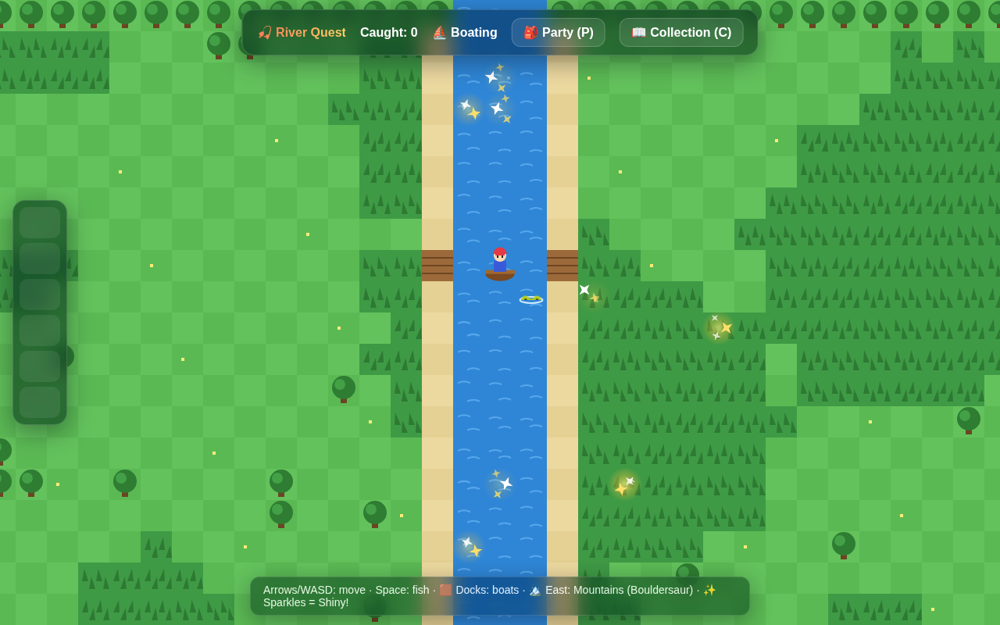
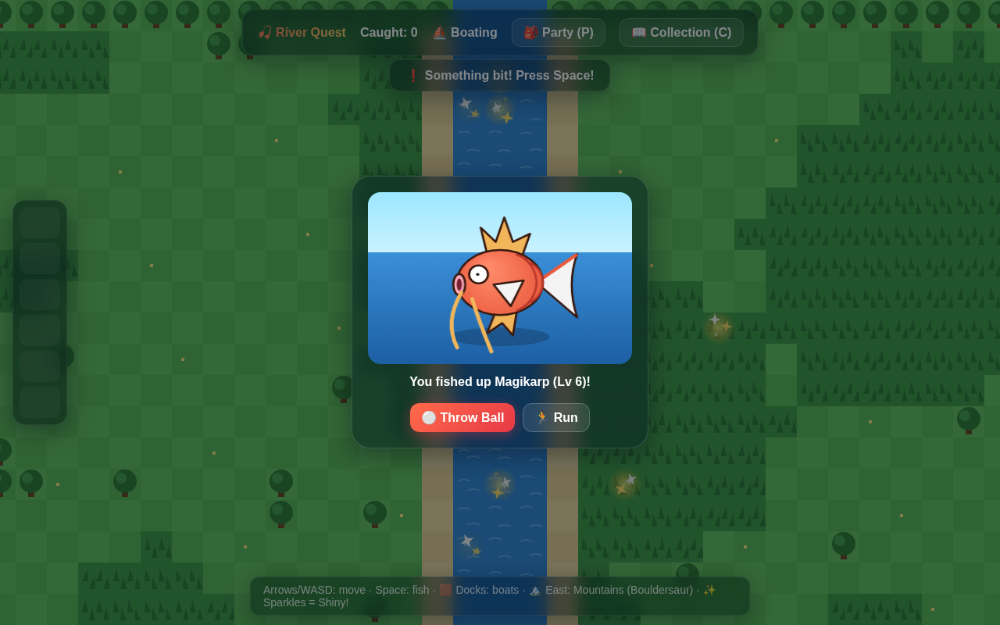
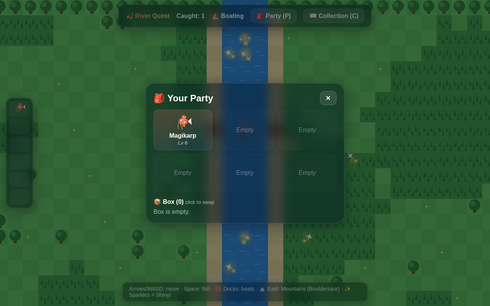

# 🎣 Magikarp River Quest

A browser adventure made for exploring, fishing, and collecting creatures. Wander
through tall grass, hop into boats at the docks, and explore the eastern mountains
in search of Bouldersaur. Watch for sparkles—you might find a shiny!

## Play

Once GitHub Pages is enabled, open **[Magikarp River Quest](https://samehmohamed88.github.io/magikarp-fishing/)**
and bookmark it. Players need only a browser—no downloads, accounts, or terminal commands.

To enable the website, open this repository's **Settings → Pages**, choose
**Deploy from a branch**, select **main** and **/ (root)**, and save.
The link may return a 404 until the first deployment finishes.

## Screenshots

Explore the rivers by boat and look for fishing spots.



Cast your rod, wait for a bite, and try to catch the creature you reel in.



Build a party of up to six creatures, with extra catches stored in your Box.



## How to play

| Action | Controls |
| --- | --- |
| Move | Arrow keys or WASD |
| Cast or reel in | Space while facing water |
| Throw a ball during an encounter | Space or **Throw Ball** |
| Open or close Party | P |
| Open or close Collection | C |
| Close a menu or run from an encounter | Escape |

Touch devices also have an on-screen direction pad and fishing button.
Step from a dock into the water to board a boat; return to a dock to get out.
When fishing, wait for the bite message, then press Space again quickly!

Discover eight species, including Magikarp, Frog, Fox, and Bouldersaur.
Every species has a rare shiny form, including pink Bunny, blue Duck, purple
Squirrel, blue Fox, and mint Hedgehog. Magikarp, Frog, and Bouldersaur keep their
existing shiny colors. Check Collection to track your catches,
and use Party to move creatures between your party and Box.

## Saved progress

Progress saves automatically in your browser. Use the same browser, device, and
website address to continue your adventure. Clearing site data removes the save;
progress does not sync between devices.

## Development

The game uses HTML, CSS, and JavaScript with no build step or package dependencies.
To play locally with automatic updates, install Git and Python 3, then run:

```bash
git clone https://github.com/samehmohamed88/magikarp-fishing.git
cd magikarp-fishing
python3 play_auto.py
```

Open **http://localhost:8000/** in your browser. On Windows, use
`py play_auto.py` instead of `python3 play_auto.py`.
The launcher checks GitHub every 60 seconds; refresh the browser after an update.
Press Ctrl+C to stop. It skips updates when tracked files have local edits and
refuses divergent history or conflicting untracked files. If GitHub is unreachable,
the game keeps running with the current files.

To use a different interval or port:

```bash
python3 play_auto.py --interval 120 --port 8001
```

Use the same port each time to keep using the same browser save. Restart the
launcher after updates to the launcher itself.

For a server without automatic updates:

```bash
./play.sh
```

To pull later changes from GitHub safely:

```bash
./update.sh
```

See [DEVELOPMENT.md](DEVELOPMENT.md) for setup, updating, and validation details.
