# 🎣 Magikarp River Quest

A browser adventure made for exploring, fishing, and collecting creatures. Wander
through tall grass, hop into boats at the docks, and explore the eastern mountains
in search of Bouldersaur. Watch for sparkles—you might find a shiny!

## 🏅 Markets, six gyms, and the Champion Door

Press **G** or tap **Gyms & Markets** to find every market and gym. Travel there
from surface land, then press **Space** or tap the nearby building button to enter.
You can also walk to the buildings. Shops and their entrances are safe from random encounters.

Six markets sell lures and Level Candies: in the meadow, snow, jungle, desert, Ember Highlands,
and Moonlit Grove. New and existing players start this update with **60 coins**.
Catches earn **10 coins**, rare catches **15**, and shiny catches **25**.
A first trainer victory earns **30 coins**; a gym victory earns **120**.

| Lure | Price | Duration | Effect |
| --- | --- | --- | --- |
| Rare Lure | 40 coins | 10 wild encounters | Rare selection weight ×3; catch chance +5 percentage points |
| Deluxe Rare Lure | 90 coins | 20 wild encounters | Rare selection weight ×5; catch chance +10 percentage points |

Buying activates the lure immediately. Only one can be active at a time, and
each wild encounter uses a charge—even if you run away. The last charge still
boosts that encounter. Battles and time spent exploring do not use charges.
Rare selection boosts apply to random meadow, biome, and fishing choices, plus
Ghost encounters on October 31. Visible swimmers keep their species, and shiny
odds and seasonal availability stay the same. Catch boosts work in every habitat.
The coin, badge, and remaining-lure display keeps track of your progress.

### 🍬 Level Candies

Buy **Level Candies for 20 coins each** at any market. Each candy raises one
creature by **one level**, up to **level 100**. Buy them while you have a lure
active, or save them for later—unused candies stay in your bag.

Choose **Give candies →** at the market, or open **Party (P) → Give candy**.
Click or tap a creature in your **Party or Box** to give it a candy. Each click
uses one candy; the creature stays in its current slot. Choose **Done giving
candies** to return to moving creatures between Party and Box. Level-100
creatures cannot consume candies. Your coins, candies, and new levels save
automatically, and the higher level strengthens the creature in battle.

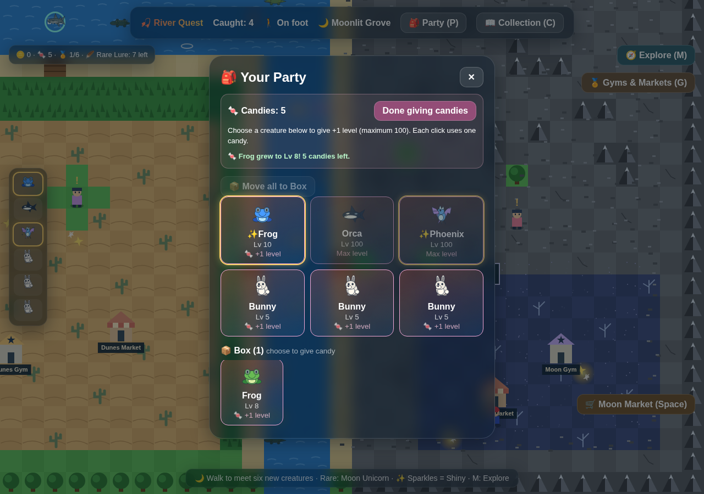

| Gym | Leader | Badge | Team levels |
| --- | --- | --- | --- |
| Meadow | Wren | Leaf | 5–6 |
| Frost | Flurry | Snowflake | 8–9 |
| Jungle | Fern | Vine | 10–12 |
| Dunes | Solis | Sun | 12–14 |
| Ember | Blaze | Flame | 15–17 |
| Moon | Selene | Moon | 18–20 |

Beat each leader's entire team to earn its badge. You can challenge the gyms in
any order and retry after a loss. Defeated gyms keep their badges and do not give
repeat rewards. Winning all six makes a glowing **Champion Door** appear just
north of the starting tunnel. Enter it to claim a **shiny Phoenix (Lv 20)** and
**200 coins**, once per save. A full party sends the Phoenix to your Box.

Coins, badges, lures, and the Champion prize save with your existing collection.
After updating, refresh the game and look for **Gyms & Markets (G)**.

## 🏆 Beyond the Champion Door: the Elite Four

Claim the Champion prize, then **walk into the glowing door** to face the Elite
Four. You can also press Space beside it and choose the next battle in the hall.
Each member has a full team of **six level-30 creatures**:

| Member | Specialty | Team |
| --- | --- | --- |
| Marina | Tides | Shark, Great White Shark, Orca, Narwhal, Megalodon, Mosasaurus |
| Rowan | Wilds | Gorilla, Tiger, Leaf Dragon, Bear, Bouldersaur, Mushroom Guardian |
| Cinder | Volcano | Lava Gecko, Ash Wolf, Ember Ram, Phoenix, Tyrannosaurus rex, Spinosaurus |
| Luna | Midnight | Moon Hare, Luna Moth, Silver Stag, Moon Lynx, Moon Unicorn, Dragonfish |

If your party is empty when you enter, you receive **six different random
level-20 creatures to keep**. They can be creatures you already own or brand-new
discoveries—even when you have creatures in the Box. They are added to Collection.
Seasonal creatures follow their usual calendar rules. An existing party keeps
its creatures and levels; you can use **Party → Move all to Box** if you want to
enter with an empty party.

Battles show large sprites of both active fighters and portraits of **both full
teams**. The current fighter is highlighted, and fainted creatures turn gray.
Use Attack, Heal, and Switch to defeat each opponent's whole team. After a win,
choose **Next** to face the next member. Your party heals between battles and
gains the normal victory level-up. You can leave and resume at the next unbeaten
member; losses and running away do not count as victories.

Defeat all four members to receive **a shiny Megalodon, a shiny Mosasaurus, and
a shiny Elasmosaurus**, all **level 30**! They join your Party when there is room
and otherwise go to your Box. The three-creature prize is awarded once per save;
you can rematch the Elite Four after completing the challenge.

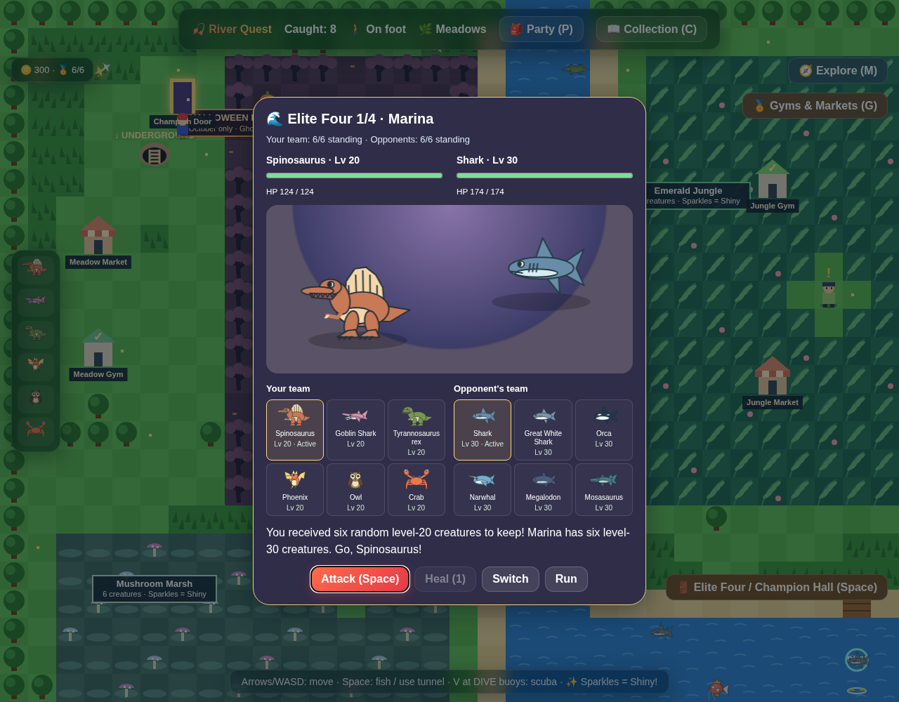

## 🧭 Five new biomes, 30 new creatures

Press **M** or tap **Explore** to find the new areas and travel to them from land.
You can also reach them on foot and by boat through the existing world. The guide
shows how many of each area's six creatures you have discovered and can take you
back to the starting meadow. All five areas are open all year.

| Area | Creatures | Rare special creature |
| --- | --- | --- |
| 🌴 Emerald Jungle | Tiger, Toucan, Chameleon, Gorilla, Sloth | Leaf Dragon |
| 🏜️ Sunstone Desert | Fennec Fox, Camel, Scorpion, Meerkat, Cobra | Sun Sphinx |
| 🍄 Mushroom Marsh | Axolotl, Salamander, Firefly, Snail, Dragonfly | Mushroom Guardian |
| 🌋 Ember Highlands | Lava Gecko, Obsidian Beetle, Cinder Bat, Ash Wolf, Ember Ram | Phoenix |
| 🌙 Moonlit Grove | Moon Hare, Luna Moth, Silver Stag, Moon Lynx, Star Tortoise | Moon Unicorn |

Walk through each habitat to encounter its creatures. Step into golden sparkles
for a **guaranteed shiny**, including a chance at a shiny special creature. All
30 have their own drawn sprites and alternate colors in encounters, Party, Box,
Collection, and battles. Specials are rarer encounters (about 6%); they can be
caught with the same balls as other creatures.

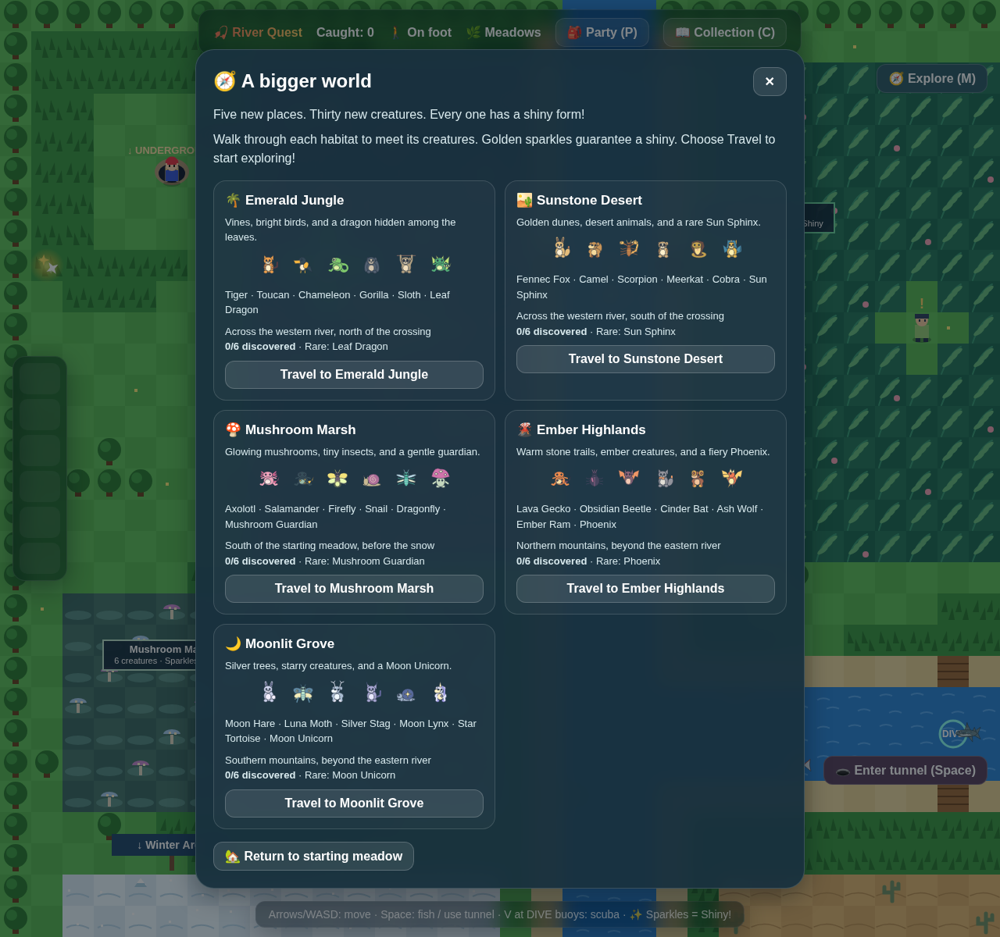

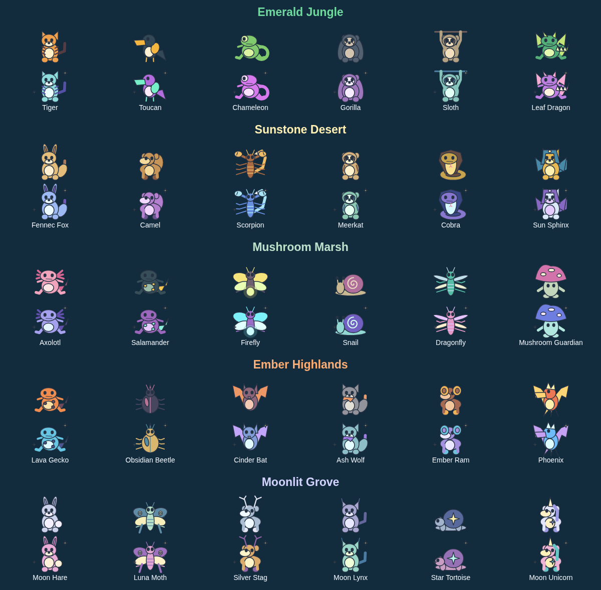

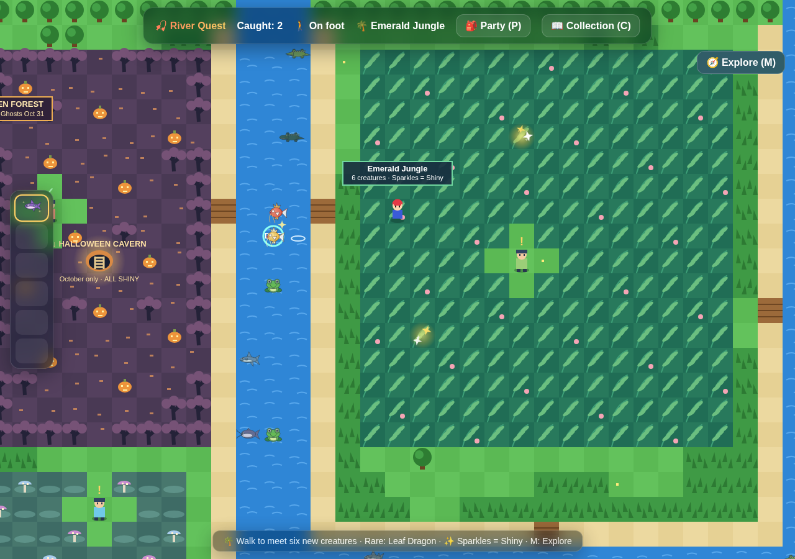

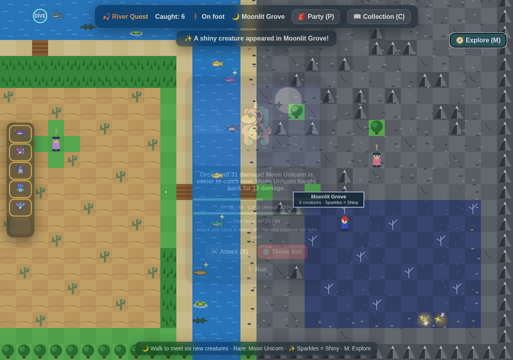

Collection now has **95 species**, a discovery counter, and filters for the new
areas. Your existing catches, shiny forms, trainer wins, and generator rewards
stay saved. The limited-edition Ghost still appears **only on October 31**.
Return to land before using fast travel; it is unavailable during encounters.

Already using the local updater? Wait for it to report the latest update, then
refresh your game. If you still see an older version, do a hard refresh
(Ctrl+Shift+R on Windows/Linux, Command+Shift+R on Mac). Look for **Explore (M)**.

## ❄ Winter Area

Head south from the starting meadow, following the path and **↓ Winter Area**
sign. No boat is needed. Explore snowy ground and falling snow to find **Snowy**,
the area's main creature (85% of winter encounters). Its yellow triangular hood,
orange trim, dark face, blue eyes, and toothy grin are based on the supplied picture.
Shiny Snowy wears an ice-blue hood with purple trim and pink eyes.

Walking through snow can trigger encounters. Step on sparkling snow for a
guaranteed shiny Snowy encounter! Snowy can be caught, saved, and added to your
Party or Box. Its shiny form is also visible in Collection's preview.

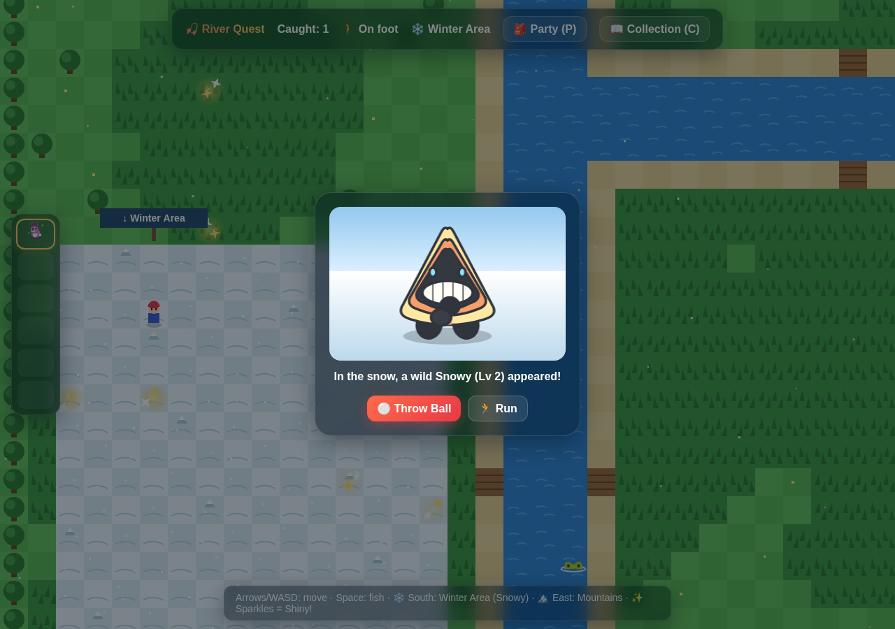

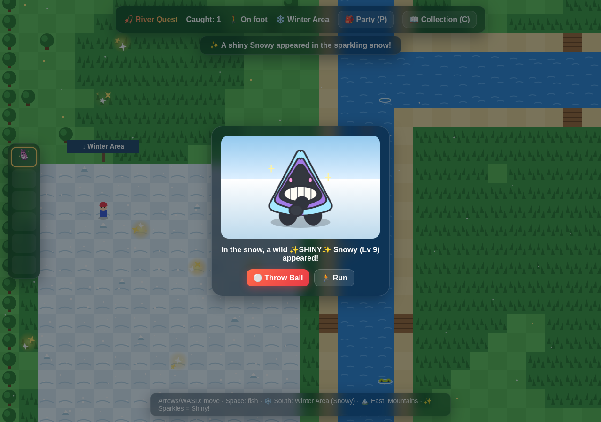

## Trainer battles

Eight trainers are waiting in small clearings across the meadows, river routes,
mountains, and Winter Area. Look for people with a **!** over their heads.
Walk onto a neighboring tile to start a battle automatically. Catch at least one
creature first: your current party is your battle team.

Choose **Attack** (or press Space), use **Heal** once per battle, or **Run**
(Escape). When a creature faints, the next party member takes over. Beat every
creature on the trainer's team to win and give each of your party creatures a level.
Your party recovers after every battle, including a loss or retreat.

Choose **Switch** to send in another party creature. The menu shows each creature's
remaining HP; active and fainted creatures cannot be selected. Switching uses your
turn, so the opponent attacks your new creature. Opening the menu or choosing
**Cancel** (Escape) costs no turn. Each creature keeps its HP when switched out.

Defeated trainers show a **✓** and will not challenge you again; wins save with
your progress. After running or losing, walk away and approach again to retry.

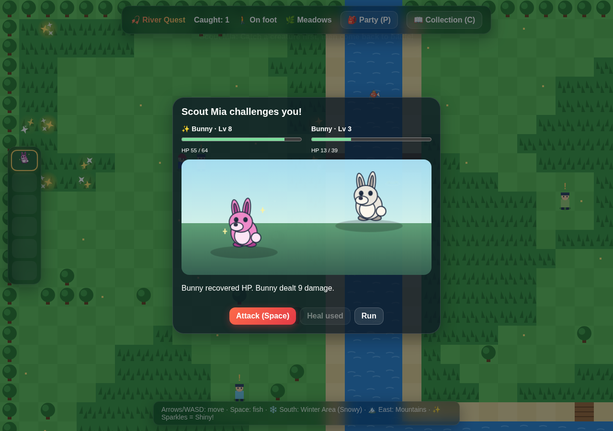

## Water wildlife

Sharks, Catfish, Grunt, Spiny Dogfish, Crocodiles, and Alligators now swim in the
rivers. Watch for their sprites from the bank or your boat. Face one and fish
into its non-sparkling tile to encounter that species; casting elsewhere can find any of the
six, along with Magikarp and Frog. Water creatures stay in the rivers and respawn
over time, with 24 surface swimmers spread across the waterways (three per fishing species).
In non-sparkling open-water fishing, the six new creatures make up 90% of encounters: Catfish
has a 20% chance, and Shark, Grunt, Spiny Dogfish, Crocodile, and Alligator each
have a 14% chance. Magikarp and Frog each have a 5% chance. Fishing directly into
a visible swimmer's non-sparkling tile still targets that creature.

Each has its own drawn sprite and shiny colors, and can join your Party, Box,
Collection, and trainer battles. Sparkling fishing spots still guarantee shinies.
**Fishing into sparkles gives a shiny Alligator 95% of the time**; the remaining
5% gives another shiny fishing species. Sparkles take priority over visible swimmers.
To help build a full shiny water team, regular fishing encounters have a **75%
shiny chance for Alligator** and a **50% shiny chance for Shark, Catfish, Grunt,
Spiny Dogfish, and Crocodile**. These chances also apply when targeting visible swimmers.
Magikarp and Frog keep their usual shiny odds.

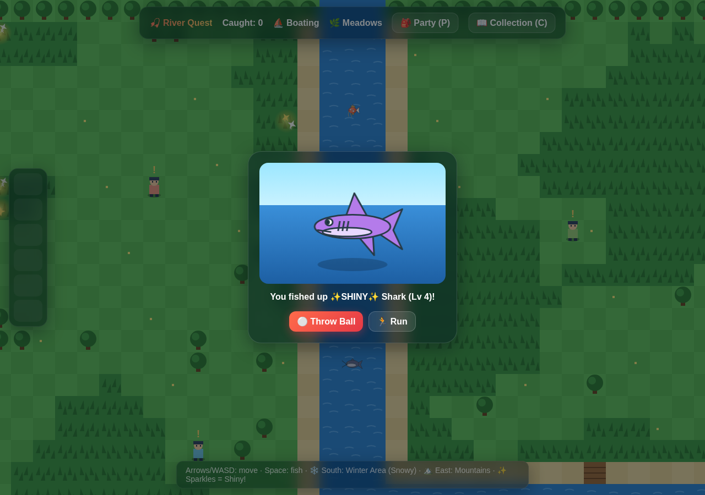

## More woodland creatures

Ten new creatures live in the tall grass: **Deer, Bear, Raccoon, Badger, Skunk,
Turtle, Owl, Mouse, Porcupine, and Red Panda**. Walk through grass to encounter
them, or step into sparkling grass for a guaranteed shiny encounter.
Together, the ten newcomers make up about 61% of meadow encounters.

Each has its own drawn sprite and shiny palette. Catch them with the same easy
catching rules, put them in your Party or Box, and use them in trainer battles.
Collection's **Preview shiny forms** shows all ten without needing to catch them.
The new land creatures won't appear while fishing or replace the Winter Area's
Snowy encounters.

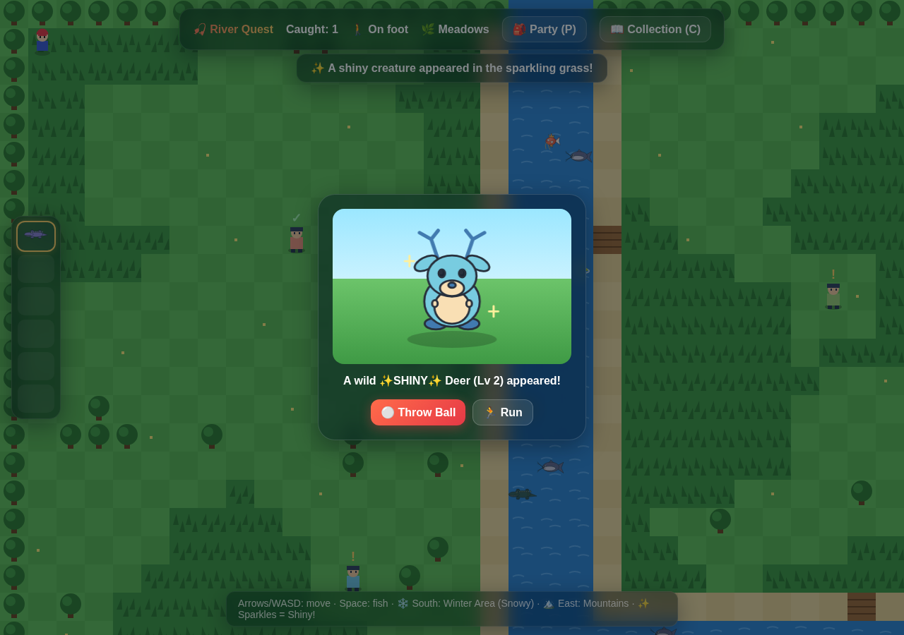

## Play

Once GitHub Pages is enabled, open **[Magikarp River Quest](https://samehmohamed88.github.io/magikarp-fishing/)**
and bookmark it. Players need only a browser—no downloads, accounts, or terminal commands.

To enable the website, open this repository's **Settings → Pages**, choose
**Deploy from a branch**, select **main** and **/ (root)**, and save.
The link may return a 404 until the first deployment finishes.

## Screenshots

Explore the rivers by boat and look for fishing spots.


Cast your rod, wait for a bite, and try to catch the creature you reel in.


Build a party of up to six creatures, with extra catches stored in your Box.


## How to play

| Action | Controls |
| --- | --- |
| Move | Arrow keys or WASD |
| Cast or reel in | Space while facing water |
| Dive at a buoy / ascend one depth | V or the Dive / Shallows / Surface button |
| Descend one diving level | B or **Dive deeper / Dive to Abyss** |
| Collect stones / use a nearby generator | Space or the on-screen action button |
| Throw a ball during an encounter | Space or **Throw Ball** |
| Weaken a wild creature | X or **Attack** |
| Attack during a trainer battle | Space or **Attack** |
| Open or close Party | P |
| Open or close Collection | C |
| Explore new biomes / travel from land | M or **Explore** |
| Close a menu or run from an encounter | Escape |

Touch devices also have an on-screen direction pad and fishing button.
Step from a dock into the water to board a boat; return to a dock to get out.
When fishing, wait for the bite message, then press Space again to reel it in.

Catching starts with at least a 92% chance on the first ball. Weakening increases
that chance, and a second ball always succeeds if your party is still in the fight.
Creatures won't run away after breaking free, but they may knock out your party.
You have four seconds to reel in after a bite.

Discover 95 species across the five new biomes, meadows, rivers, caves, seasonal forest, and three
diving levels, including Magikarp, Bouldersaur, Orca, and Anglerfish.
Every species has a shiny form, including pink Bunny, blue Duck, purple
Squirrel, blue Fox, and mint Hedgehog. Magikarp, Frog, and Bouldersaur keep their
existing shiny colors. Check Collection to track your catches,
and use Party to move creatures between your party and Box.
You can move even the last creature into the Box, or choose **Move all to Box**
to empty your party at once. Your creatures and Collection progress stay saved.
Click any creature in the Box to add it back. Put at least one in your party
before approaching a trainer to battle.
In Collection, choose **✨ Preview shiny forms** to see all 95 shiny designs
without changing your catches or saved progress. Bunny, Duck, Squirrel, Fox,
and Hedgehog use drawn sprites so their colors are consistent across devices.

## Scuba diving

Look for glowing **DIVE** buoys in the western river (just south of the northern
docks), the eastern river, and the middle river crossing. Sail onto a buoy and
press **V** or tap **Dive**. Swim with the arrow keys or WASD and touch a swimming
creature to encounter it—no fishing rod needed underwater!

All eight fishing species swim here, including Magikarp and Frog.
Seven more species—**Narwhal, Crab, Lobster, Starfish, Mussel, Octopus, and Squid**—
can only be encountered and caught while diving. They are hidden above the surface
and cannot be hooked with a fishing rod. All seven have distinct shiny forms.

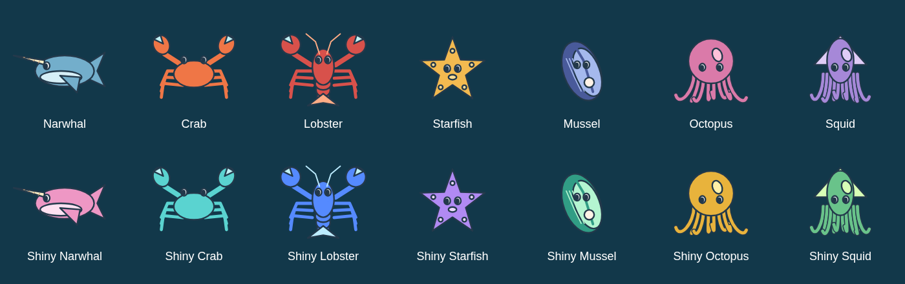

Shiny swimmers
have their alternate colors and a small star; their shiny form stays with them
when encountered and caught. Press **V** or tap **Surface** anywhere underwater
to return to your boat. There is no air timer. Normal fishing still works above
water, and your diving position saves automatically.

## Dive deeper: the Deep Sea

While scuba diving, press **B** or tap **Dive deeper**. The deeper basin contains
all the fishable river creatures and all seven diving-only creatures, plus:

- **Giant Squid** and **Colossal Squid**
- **Great White Shark** and **Tiger Shark**
- **Orca**

Swim into a creature to encounter it. Each new species has its own normal and
shiny appearance. The five new species are found only in the deep sea.
Press **V / Shallows** to return to the place where you descended, then V again
to return to your boat. There is no air timer, and your depth and position save.

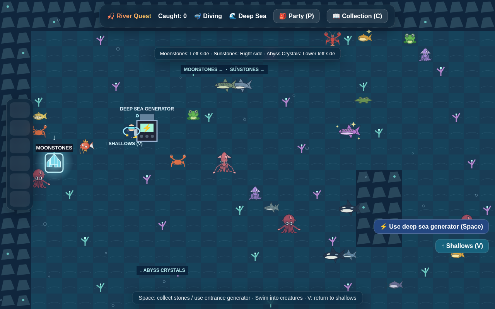

The **Deep Sea Generator is right at the entrance**. Find the glowing stone piles
at the sides of the area, swim onto them or press **Space / Collect**, and bring
them back to the generator. Choose **Insert** to receive the matching creature:

| Glowing stones | Location | Reward |
| --- | --- | --- |
| Moonstones | Left side | Mosasaurus |
| Sunstones | Right side | Megalodon |
| Abyss Crystals | Lower left side | Elasmosaurus |

You can earn **all three**, once each per save, in any order. Collecting a stone
alone does not award its creature. Rewards are level 10 and go to your Party or
to your Box if the Party is full. These three creatures come from the deep-sea
generator; they do not spawn as wild swimmers. Stone and reward progress saves
immediately and is separate from the cave's dinosaur generator.

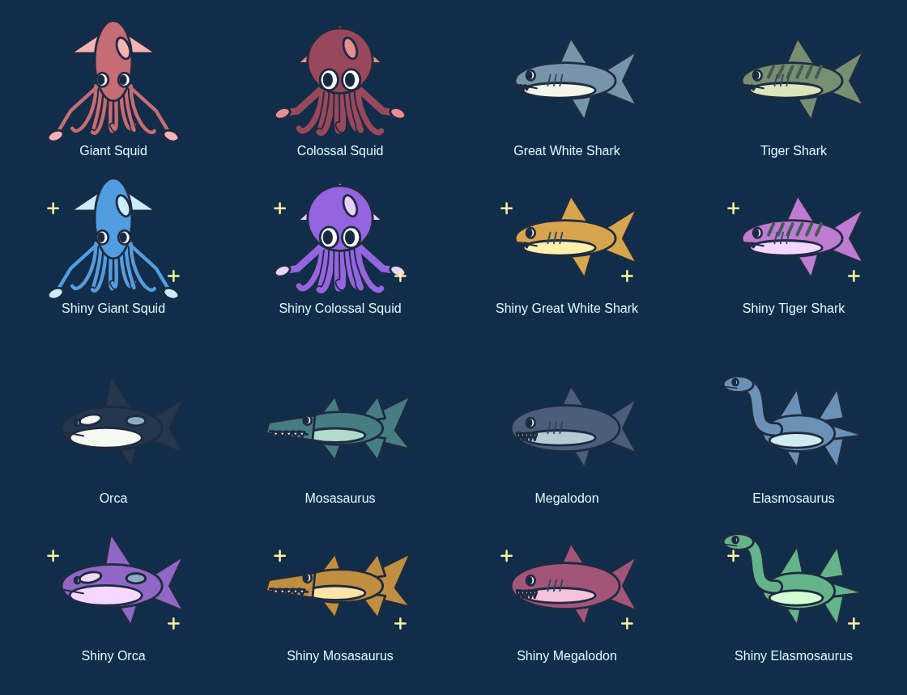

## Scuba-diver trainers

Look for divers with **!** markers in the **Deep Sea (level 2)**. Swim beside
**Diver Coral**, **Diver Finn**, or **Captain Marina** with a creature in your party
to battle their water-creature teams. Attack, heal, switch, or run using the same
controls as land trainers. Wins save and give each party creature a level; defeated
divers show a check mark. Your party recovers after the battle.

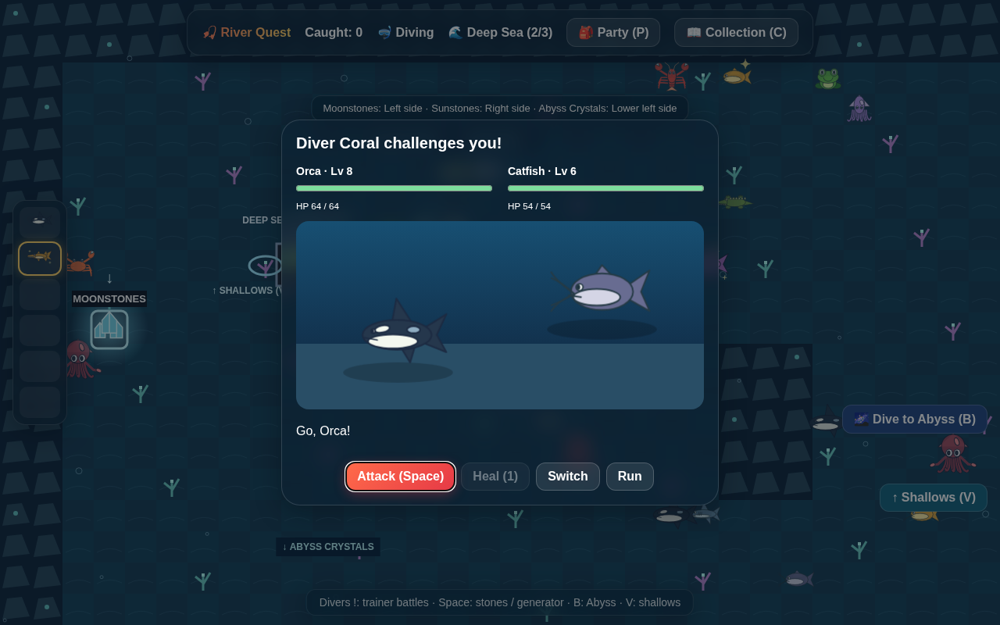

## The Abyss — diving level 3

From the Deep Sea, press **B / Dive to Abyss** to reach the third and deepest level.
Explore glowing coral and underwater vents to find **12 species** exclusive to
this level:

- **Anglerfish, Gulper Eel, and Dumbo Octopus**
- **Goblin Shark, Frilled Shark, and Viperfish**
- **Dragonfish, Barreleye, and Vampire Squid**
- **Giant Isopod, Nautilus, and Sea Pig**

There are 60 roaming creatures, five of each species. Swim into one to encounter
it, weaken it with Attack, and throw a ball to catch it. Every species has its own
sprite and shiny colors, visible while swimming, in encounters, in your Party or
Box, in Collection, and in trainer battles. Look for the star beside shiny swimmers!
Your catches and position save automatically, and existing saves gain the new
creatures as soon as the updated game loads.

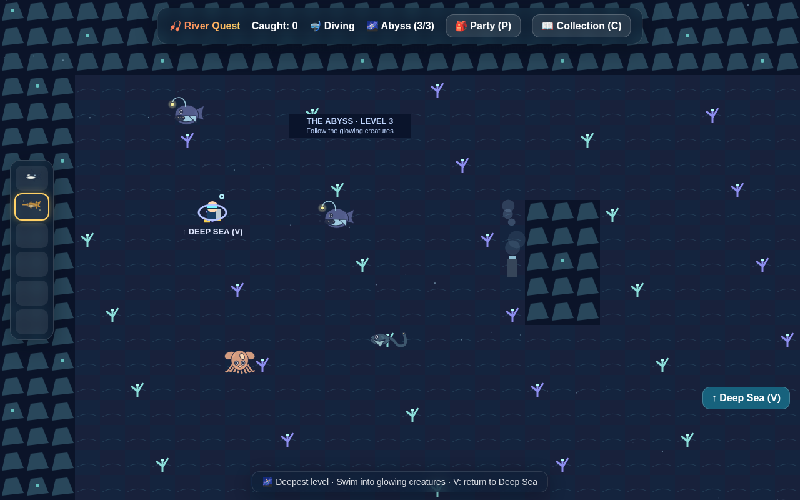

Press **V / Deep Sea** to return to the exact level-2 location where you descended.
Press V again for the shallows and once more for your boat. B always goes down
one level; V goes up one level. The stone generator and diver trainers are on
level 2. There is no oxygen timer.

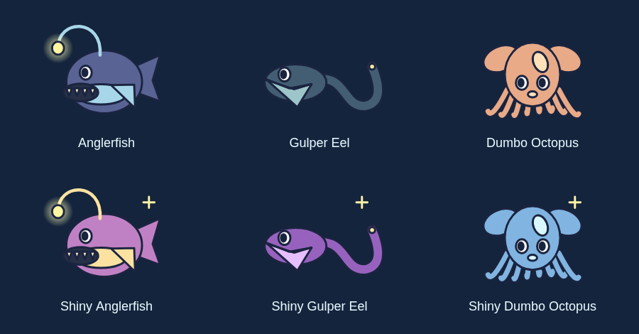

## Weakening and wild-creature battles

Wild encounters show both creatures' HP. With a creature in your party, choose
**Attack (X)** to lower the wild creature's HP and improve the catch chance.
Your attacks leave it at **at least 1 HP**, so you can still catch it. At 1 HP,
the next ball is guaranteed to succeed if your party has survived.

The wild creature **fights back after each attack and after a failed catch**.
It can knock out your active creature; the next surviving party member takes over
automatically. If your entire party is knocked out, you must leave the encounter
before you can try again. Your party recovers when you leave, and you keep all
previous catches. Successful catches do not trigger a counterattack.

You can still throw balls without attacking. If you have no party yet, catch
your first creature to unlock Attack. **Run** leaves the encounter at any time
when a throw animation is not in progress.

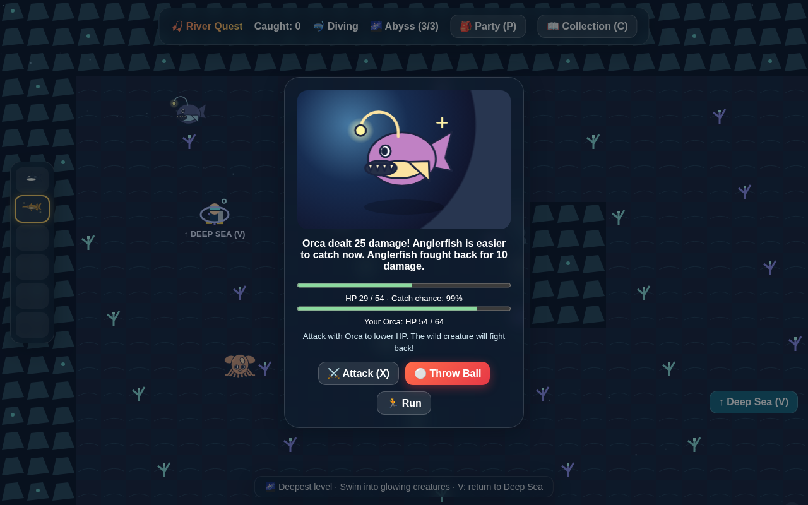

## Underground caves

A tunnel sits in the **middle of the starting clearing**. Stand on or beside it
and press **Space**, or tap **Enter tunnel**, to explore the Crystal Caves.
Walk into **Moles, Ants, Spiders, Crickets, Praying Mantises, and Cave Crawfish**
to encounter and catch them. These six species are exclusive to the caves, and
all have shiny forms. Cave crawfish live in shallow pools you can walk through.

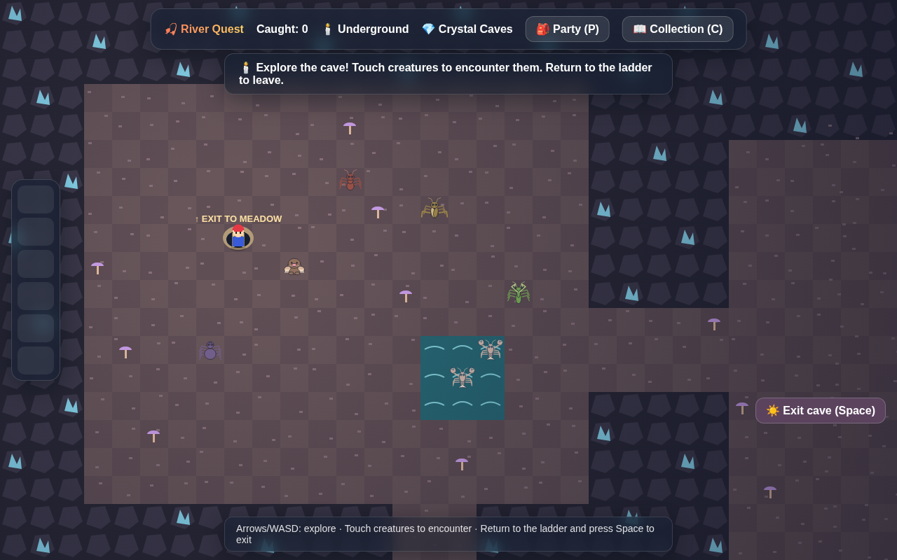

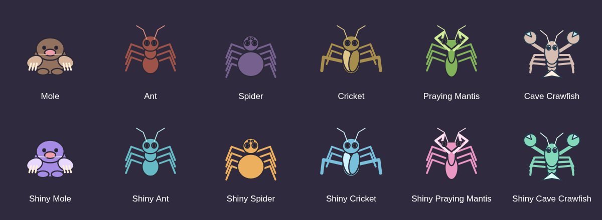

Return to the **EXIT TO MEADOW** ladder and press **Space** or tap **Exit cave**
to return outside. Your cave location and catches save automatically.

Wild encounters are less frequent: grass and mountains have an 8% chance per
step, and snow has a 10% chance. After a wild encounter ends, you get four seconds
without another random or collision encounter. The same protection applies after
loading your save. Fishing remains under your control.

## Cave stones and dinosaur generator

The **generator is beside the entrance ladder**. The three bright, labeled piles
are grouped at the front of the entrance chamber. Walk onto a pile to collect it,
or stand beside it and press **Space** / tap **Collect**.

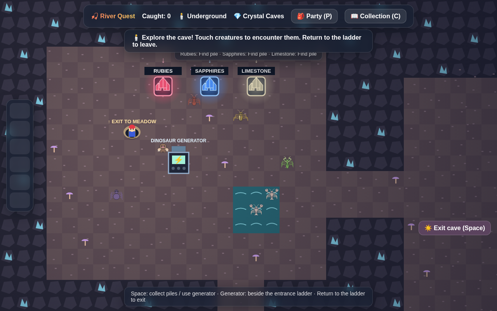

Bring each pile to the generator, press **Space** / tap **Use generator**, then
choose **Insert** for that pile:

| Stone pile | Generator reward |
| --- | --- |
| Rubies | Tyrannosaurus rex |
| Sapphires | Spinosaurus |
| Limestone | Giganotosaurus |

**The generator gives you the normal forms of these dinosaurs.** During October,
you can also catch their shiny forms in the limited-edition Halloween Cavern.
Collecting a pile alone does not award a dinosaur. You can earn **all three**, in
any order, once each per save. Each dinosaur starts at level 10 and joins your
party, or your Box if your party is full. Collected piles and claimed rewards save
immediately, so you can leave, reload, and finish later.

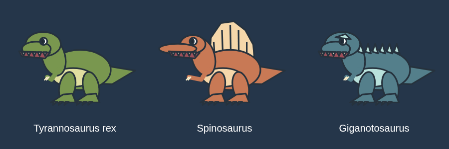

## Halloween Forest — October event

Golden sparkles appear on the forest floor too! Step onto a sparkling tile for
a guaranteed shiny Halloween creature with its special colors. The sparkles
disappear after the encounter starts. Ghosts still appear only on October 31.

During **October**, walk east/northeast from the starting clearing to the
pumpkin sign for **Halloween Forest**. Skeletons, Crows, and Zombies appear only
in this seasonal forest. On **October 31 only**, a **Ghost** has a rare 5% chance
among forest encounters. A shiny Ghost also roams Halloween Cavern on October 31.
Ghosts cannot spawn on other dates.
The forest uses the same 8% per-step encounter rate and four-second cooldown.

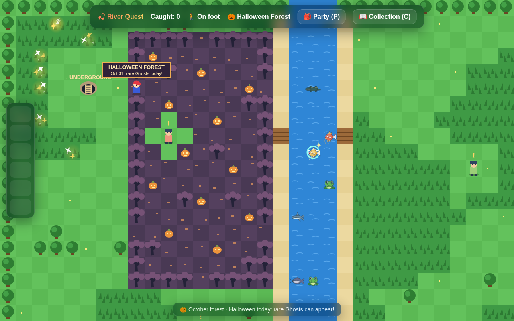

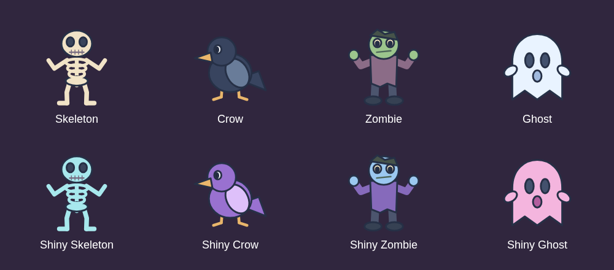

The event follows **your device's local date** and returns each October. The
forest appears/disappears as the date changes, even with the game open. Catches,
including Ghosts, remain in Party, Box, and Collection all year. If the forest
closes while you are standing where a normal tree returns, you move safely to
the starting clearing. An encounter already underway can still be completed.

## Halloween Cavern — every creature is shiny!

During **October**, find the glowing **HALLOWEEN CAVERN** ladder in the middle
of Halloween Forest. Stand on or beside it and press **Space**, or tap
**Enter Halloween Cavern**. Explore pumpkin-lit chambers and purple pools, then
walk into the roaming creatures to encounter them. **Every creature is shiny**,
both on the map and when caught:

- **Spinosaurus, Tyrannosaurus rex, and Giganotosaurus**
- **Mole, Ant, Spider, Cricket, Praying Mantis, and Cave Crawfish**
- A rare **Ghost on October 31 only**

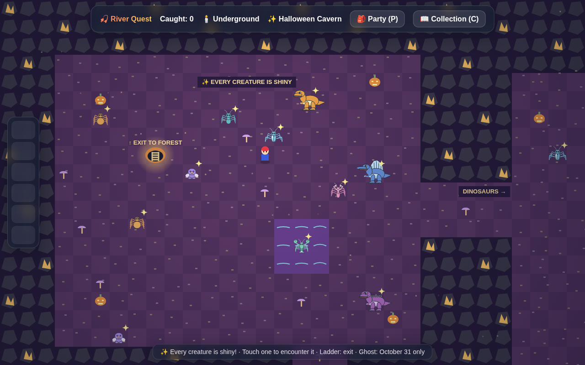

Return to the **EXIT TO FOREST** ladder and press Space or tap **Exit to forest**.
Your location and catches save automatically. On November 1 the cavern closes
and returns you safely to the starting clearing, including if you reload an old
cavern save. An unfinished cavern encounter ends when it closes; creatures
already caught remain in your Party, Box, and Collection all year. The cavern
returns each October according to your device's local date.

## Saved progress

Progress saves automatically in your browser. Use the same browser, device, and
website address to continue your adventure. Clearing site data removes the save;
progress does not sync between devices.

## Development

The game uses HTML, CSS, and JavaScript with no build step or package dependencies.
To play locally with automatic updates, install Git and Python 3, then run:

```bash
git clone https://github.com/samehmohamed88/magikarp-fishing.git
cd magikarp-fishing
python3 play_auto.py
```

Open **http://localhost:8000/** in your browser. On Windows, use
`py play_auto.py` instead of `python3 play_auto.py`.
The launcher checks GitHub every 60 seconds; refresh the browser after an update.
Press Ctrl+C to stop. It skips updates when tracked files have local edits and
refuses divergent history or conflicting untracked files. If GitHub is unreachable,
the game keeps running with the current files.

To use a different interval or port:

```bash
python3 play_auto.py --interval 120 --port 8001
```

Use the same port each time to keep using the same browser save. Restart the
launcher after updates to the launcher itself.

For a server without automatic updates:

```bash
./play.sh
```

To pull later changes from GitHub safely:

```bash
./update.sh
```

See [DEVELOPMENT.md](DEVELOPMENT.md) for setup, updating, and validation details.
